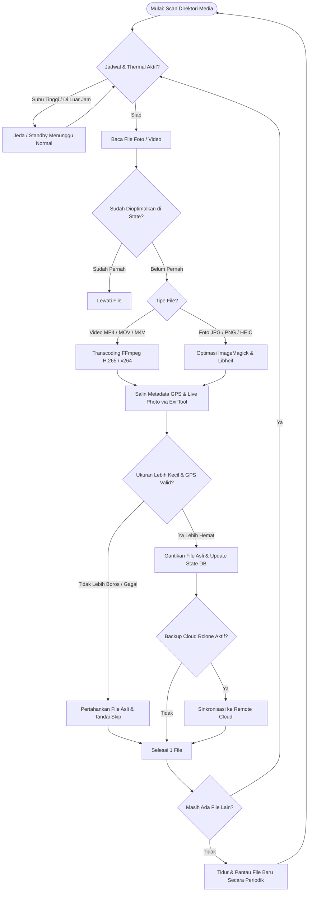
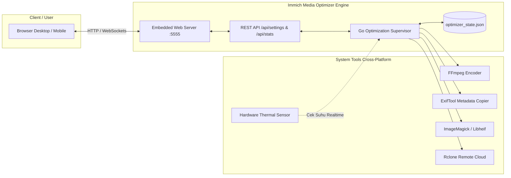

# Immich Media Optimizer & Web Monitor 🚀

Aplikasi optimasi dan kompresi media (foto & video) otomatis terintegrasi Web Dashboard monitor profesional yang dirancang hemat memori (~10-15MB RAM) untuk server mandiri (ODROID, Raspberry Pi, VPS, Debian/Ubuntu, Arch, Fedora, macOS).

Mirror repositori ini dibuat sebagai **arsip cadangan (backup pemulihan)** agar memudahkan instalasi ulang sistem secara instan jika sewaktu-waktu OS Linux diinstall ulang (*disaster recovery*).

---

## 📑 Daftar Isi
- [Fitur Utama](#-fitur-utama)
- [Diagram Alur Sistem (Flowchart)](#-diagram-alur-sistem-flowchart)
- [Struktur Repositori](#-struktur-repositori)
- [Persyaratan Sistem (Cross-Platform)](#-persyaratan-sistem-cross-platform)
- [Panduan Instalasi Cepat (`install.sh`)](#-panduan-instalasi-cepat-installsh)
- [Penggunaan & Manajemen](#-penggunaan--manajemen)
- [Konfigurasi (`config.json`)](#-konfigurasi-configjson)
- [Panduan Push ke GitHub Pribadi](#-panduan-push-ke-github-pribadi)

---

## 🌟 Fitur Utama

1. **⚡ Ultra-Low Resource Binary (Golang)**: Berjalan sebagai single-binary Go murni tanpa runtime Python/Node yang berat, hanya mengonsumsi ~10–15 MB RAM.
2. **🎨 Web Dashboard Modern (Port 5555)**: Dashboard dark-slate bertema Adminator lengkap dengan statistik real-time, grafik storage saved, tab pengaturan dinamis, dan live logs.
3. **📍 Preservasi Mutlak GPS & Metadata (Zero GPS Loss)**:
   - Metadata EXIF GPS, waktu, tanggal pembuatan, orientation, serta tag QuickTime lokasi dipertahankan 100%.
   - Dilengkapi **verifikasi validasi otomatis**: Jika file asli memiliki koordinat GPS, file hasil kompresi wajib memiliki koordinat GPS yang sama sebelum digantikan.
4. **📷 Preservasi Penuh Apple Live Photos**:
   - Tag khusus Apple (`ContentIdentifier`, `MediaGroupUUID`, dan `MakerNotes`) disalin secara utuh sehingga efek foto bergerak Live Photos tetap berfungsi interaktif di iOS / Immich.
5. **🛡️ Atomic Replace & Skip Boros**:
   - Menggunakan mekanisme safety swap: jika ukuran hasil kompresi ternyata lebih besar dari file asli (*over-compression*), file asli tetap dipertahankan utuh.
6. **🌡️ Thermal Guard Otomatis**:
   - Memonitor suhu CPU (misal: ODROID/SBC). Jika suhu melewati batas ambang (default: 75°C), proses kompresi otomatis diistirahatkan hingga suhu normal kembali (<65°C).
7. **☁️ Integrasi Backup Rclone**:
   - Dukungan backup otomatis berkala ke remote cloud storage (Google Drive, MEGA, Onedrive, dll).

---

## 📊 Diagram Alur Sistem (Flowchart)

Diagram alur berikut dirender langsung dan terbaca di GitHub menggunakan format **Mermaid**:



### Flowchart Komponen & Arsitektur Sistem



---

## 📁 Struktur Repositori

```text
git/
├── install.sh             # 🌟 Wizard instalasi otomatis cross-platform & interaktif
├── install-service.sh     # Script setup systemd service khusus Linux boot
├── onerun.sh              # Runner langsung di console/terminal
├── main.go                # Source code backend Go lengkap (server, worker, engine)
├── main_test.go           # Unit testing suite
├── go.mod                 # Go module definition
├── config.example.json    # Template konfigurasi bawaan
├── static/                # Aset Web UI (HTML, CSS, JS Adminator Dashboard)
│   ├── index.html
│   ├── style.css
│   └── app.js
└── .gitignore             # Mencegah file binari & state log terunggah
```

---

## 💻 Persyaratan Sistem (Cross-Platform)

Program ini kompatibel dan dapat dijalankan di berbagai sistem operasi:
- **Linux (Semua Distro)**:
  - Debian / Ubuntu / DietPi / Raspberry Pi OS (`apt`)
  - Arch Linux / Manjaro (`pacman`)
  - Fedora / RHEL / CentOS (`dnf`)
  - Alpine Linux (`apk`)
- **macOS**: Mendukung arsitektur Intel & Apple Silicon (M1/M2/M3) via `brew`.
- **Arsitektur CPU**: x86_64, ARM64 (aarch64), ARMv7.

Semua paket yang diperlukan (`ffmpeg`, `exiftool`, `imagemagick`, `libheif`, `rclone`, `go`) akan **diperiksa dan diinstall otomatis** oleh `install.sh`.

---

## 🚀 Panduan Instalasi Cepat (`install.sh`)

Ketika Anda baru saja menginstall ulang Linux atau memasang di komputer baru, Anda hanya perlu menjalankan:

```bash
cd git/
chmod +x install.sh
./install.sh
```

### Apa yang Dilakukan oleh `install.sh`?
1. **Deteksi Otomatis Sistem Operasi & Package Manager** (`apt`, `pacman`, `dnf`, `apk`, `brew`).
2. **Menginstall Seluruh Dependensi** yang dibutuhkan secara otomatis tanpa konfigurasi manual yang rumit.
3. **Setup Wizard Interaktif**:
   - Meminta input folder foto/video yang akan diolah (misal: direktori upload Immich `/mnt/hdd1/immich/upload/upload`).
   - Meminta input port Web UI (default: `5555`).
   - Menentukan preferensi kompresi (Video CRF & Photo Quality).
   - Menentukan password akses Web UI (otomatis di-hash SHA-256).
4. **Otomatis Mengompilasi Binary Go** menjadi executable lokal `optimizer`.
5. **Opsi Registrasi Systemd Service (Linux)**: Menawarkan apakah ingin langsung dijalankan otomatis tiap boot (*auto-run on startup*).

---

## 🛠️ Penggunaan & Manajemen

### 1. Menjalankan Manual di Terminal
```bash
./optimizer
# Atau menggunakan runner:
./onerun.sh
```

### 2. Mengelola Systemd Service (Jika Diaktifkan)
```bash
# Cek status berjalan
sudo systemctl status immich-optimizer

# Restart service
sudo systemctl restart immich-optimizer

# Hentikan service
sudo systemctl stop immich-optimizer

# Pantau log secara real-time
sudo journalctl -u immich-optimizer -f
```

### 3. Mengakses Web Dashboard
Buka browser dari perangkat mana saja yang berada dalam satu jaringan lokal:
```text
http://<IP-SERVER-ANDA>:5555
```
- Masukkan password yang telah Anda atur saat instalasi (default: `admin`).

---

## ⚙️ Konfigurasi (`config.json`)

Contoh berkas konfigurasi default:

```json
{
  "server": {
    "host": "0.0.0.0",
    "port": 5555,
    "auth_enabled": true,
    "password_hash": "8c6976e5b5410415bde908bd4dee15dfb167a9c873fc4bb8a81f6f2ab448a918",
    "password_hint": "admin (default)"
  },
  "storage": {
    "immich_upload_dir": "/mnt/hdd1/immich/upload/upload",
    "state_file_path": "optimizer_state.json",
    "log_dir": "logs"
  },
  "compression": {
    "mode": "force",
    "video_codec": "libx265",
    "video_preset": "ultrafast",
    "video_crf": 26,
    "video_max_height": 1080,
    "video_threads": 1,
    "photo_quality": 82,
    "photo_max_dim": 2560,
    "max_video_workers": 1,
    "max_photo_workers": 2
  },
  "thermal": {
    "enabled": true,
    "max_temp_c": 75,
    "cooldown_temp_c": 65,
    "thermal_zone_path": "/sys/class/thermal/thermal_zone0/temp"
  },
  "schedule": {
    "enabled": true,
    "start_hour": 1,
    "end_hour": 6
  },
  "backup": {
    "enabled": false,
    "mode": "normal",
    "rclone_remote": "mega:ImmichBackup",
    "rclone_args": "--transfers=1 --checkers=2 --fast-list --bwlimit=5M"
  }
}
```
*Catatan: Semua nilai di atas juga bisa diedit langsung melalui Web UI pada menu **Settings**.*

---

## 🐙 Panduan Push ke GitHub Pribadi

Untuk mengunggah mirror ini ke akun GitHub Anda sendiri:

1. Buat repository baru di GitHub (misalnya bernama: `immich-media-optimizer`).
2. Masuk ke folder mirror dan inisialisasi Git:
   ```bash
   cd /home/bawen/antigravity/kompresor/git
   git init
   git add .
   git commit -m "feat: inisiasi mirror immich media optimizer backup"
   ```
3. Hubungkan ke repository GitHub Anda dan push:
   ```bash
   git branch -M main
   git remote add origin https://github.com/<USERNAME-ANDA>/<NAMA-REPO-ANDA>.git
   git push -u origin main
   ```

Jika di masa mendatang Anda menginstall ulang server/komputer Anda, Anda cukup melakukan:
```bash
git clone https://github.com/<USERNAME-ANDA>/<NAMA-REPO-ANDA>.git
cd <NAMA-REPO-ANDA>
./install.sh
```
Sistem Anda akan kembali pulih 100% secara otomatis! 🎉
